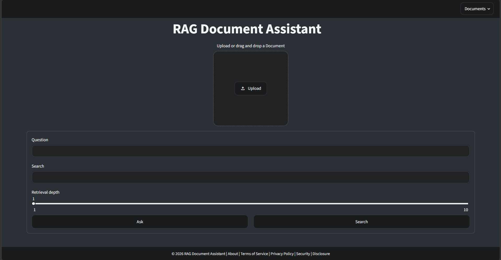

# RAG Document Assistant

An Aritifical Intelligence Document Assistant that utilizes Retrieval-Augmented Generation and lets you upload documents, index the contents in a vector database, and ask grounded questions about them using OpenAI models.

## Features

- Upload multiple files in supported formats: PDF, DOCX, HTML, TXT, and Markdown
- Extract text and split large documents into overlapping chunks
- Generate embeddings with the OpenAI `text-embedding-3-large` model
- Store chunks in a Qdrant collection keyed by document source
- Search using hybrid ranking: vector similarity plus lexical overlap
- Keep recent chat history for follow-up questions
- Display source document names with responses
- Delete individual indexed documents from the sidebar
- Run ingestion and query flows asynchronously through Inngest

## How it works

Users upload documents in the Streamlit app, and the backend ingests them through a FastAPI/Inngest workflow that splits each file into chunks, embeds them with OpenAI, and stores them in Qdrant for retrieval. When a question is asked, the system embeds the query, searches the indexed chunks for the most relevant passages, and passes that grounded context to the LLM to generate an answer tied to the uploaded documents.

## Tech stack

- Python
- Streamlit
- FastAPI
- Inngest
- Qdrant
- OpenAI API
- LlamaIndex

## Getting Started
### Prerequisites

- OpenAI API key

### Installation

#### 1) Clone the repository

```bash
git clone https://github.com/mohamedaradaib/rag-document-assistant.git
cd rag-document-assistant
```

#### 2) Create an environment file

Create a `.env` file in the project root:

```env
OPENAI_API_KEY=your_openai_api_key
```

#### 3) Install dependencies

```bash
uv sync
```

#### 4) Start Qdrant

```bash
docker compose up -d
```

#### 5) Start Inngest

In a separate terminal:

```bash
npx inngest-cli@latest dev
```

#### 6) Start the FastAPI app

In another seperate terminal:

```bash
uv run uvicorn main:app --reload --port 8000
```

#### 7) Start the Streamlit UI

In another seperate terminal:

```bash
uv run streamlit run streamlit_app.py
```

Then open localhost:

```text
http://localhost:8601
```

## Live Demo
https://rag-document-assistant-production-443d.up.railway.app/

## Screenshots


## License

[LICENSE](LICENSE)
